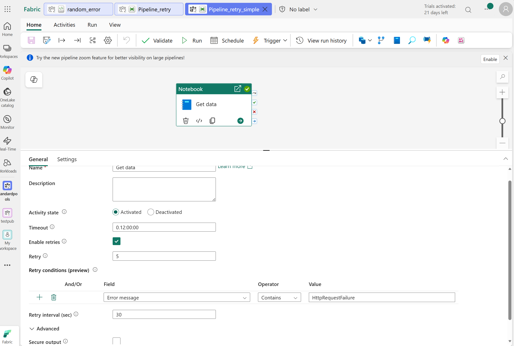
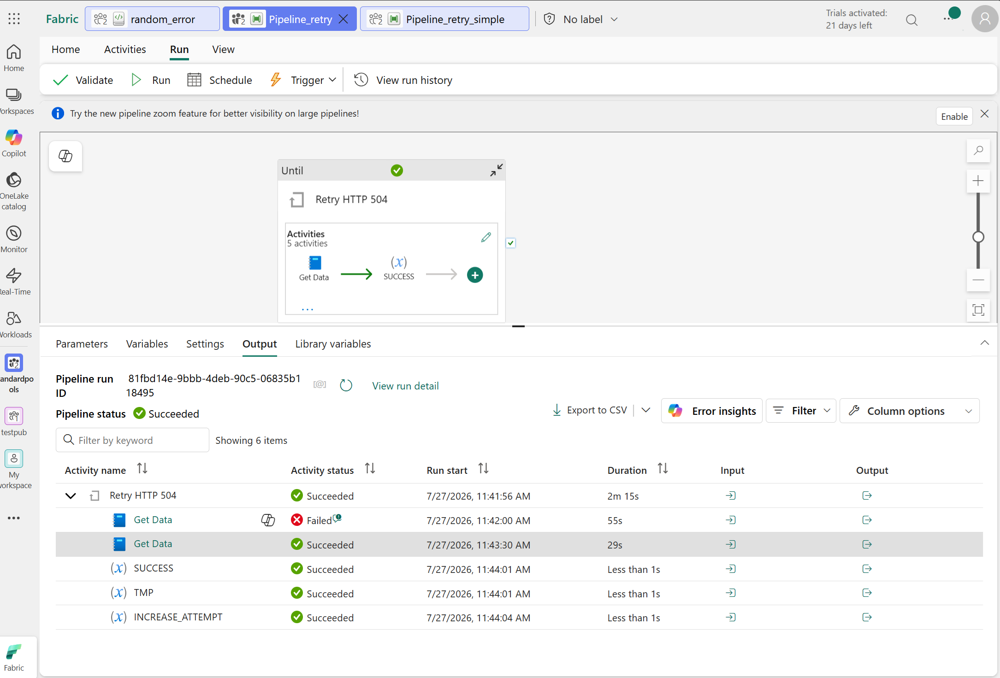

# Fabric Retry Pipeline

Two Microsoft Fabric Data Factory pipelines that show how to **retry a notebook only on specific transient errors** (in this example, `HttpRequestFailure` raised inside [random_error.ipynb](random_error.ipynb)). Any other exception (e.g. `ZeroDivisionError`) is treated as fatal and the pipeline stops immediately.

Two options are provided:

| # | File | Approach | When to use |
| - | ---- | -------- | ----------- |
| 1 | [Fabric_pipeline_simple.json](Fabric_pipeline_simple.json) | Built‑in **conditional retry** on the Notebook activity (preview feature). | Simple, one‑activity retry with an expression condition. |
| 2 | [Fabric_pipeline_until.json](Fabric_pipeline_until.json) | **`Until` loop** wrapping the Notebook activity with a small state machine. | GA feature; more control (custom exit signals, backoff, retry counter, complex branching). |

Both pipelines assume the notebook raises a custom exception class `HttpRequestFailure` for retryable failures — see [random_error.ipynb](random_error.ipynb) for an example.

---

## Get started — deploy either pipeline

Both files are Fabric pipeline JSON definitions. To deploy them into your Fabric workspace:

### Option A — Import via Fabric UI

1. In your Fabric workspace, choose **New → Data pipeline**.
2. Give the pipeline a name and open it in the designer.
3. Top toolbar → **View** → **JSON view** (or **Edit JSON**).
4. Paste the entire contents of the desired file (`Fabric_pipeline_simple.json` or `Fabric_pipeline_until.json`).
5. Update these IDs to point at **your** notebook:
   - `notebookId` → your notebook's ID.
   - `workspaceId` → your workspace ID.
   - (Until‑loop option only) remove `externalReferences.connection` or replace it with a valid connection ID for your tenant.
6. **Save** → **Publish**.

### Option B — Via Fabric REST API / `fabric-cli`

1. Install [fabric-cli](https://learn.microsoft.com/fabric/cli) and sign in: `fab auth login`.
2. From this folder, create the item:
   ```powershell
   fab item create --workspace <workspace-name> --type DataPipeline --file .\Fabric_pipeline_simple.json
   ```
3. Replace `notebookId` / `workspaceId` inside the JSON before importing, or edit them in the UI afterwards.

### Prerequisites

- A Microsoft Fabric workspace with a Data Factory license.
- A notebook that raises a distinguishable exception class for the retryable case (see [random_error.ipynb](random_error.ipynb)).
- For **Option 1** only: the Notebook activity **conditional retry** preview feature must be available in your tenant.

### Test it

Run the pipeline several times. `random_error.ipynb` randomly picks one of three outcomes:

- Success → notebook exits with `SUCCESS`, pipeline completes.
- `HttpRequestFailure` → pipeline **retries** (up to 5 times).
- `ZeroDivisionError` → pipeline **stops immediately** as fatal.

---

## Option 1 — Simple: conditional retry on the Notebook activity (preview)



The Notebook activity itself decides whether to retry, based on an expression that inspects `activity('Get data').Error.Message`. No loops, no helper variables.

Key part of [Fabric_pipeline_simple.json](Fabric_pipeline_simple.json):

```json
"policy": {
    "timeout": "0.12:00:00",
    "retry": 5,
    "retryIntervalInSeconds": 30,
    "retryConditions": {
        "type": "Expression",
        "value": "@contains(activity('Get data').Error.Message, 'HttpRequestFailure')"
    }
}
```

Behavior:

| Notebook outcome     | `Error.Message` contains `HttpRequestFailure`? | Result |
| -------------------- | :--------------------------------------------: | ------ |
| Success              | n/a                                            | Pipeline succeeds. |
| `HttpRequestFailure` | ✅                                              | Retried up to 5× with 30s between attempts. |
| Any other exception  | ❌                                              | Fails immediately, no retry. |

Pros:

- One activity, no variables, no loop.
- Trivial to add to an existing pipeline.

Cons / caveats:

- **Preview feature** — availability depends on your tenant.
- The retry decision is a substring match on `Error.Message`. Pick a substring that appears **only** in the retryable exception's message and never in unrelated Python source lines the traceback may echo.
- No custom counter/state; only what the activity policy exposes.

---

## Option 2 — `Until` loop with a state machine



Wraps the Notebook call in an `Until` activity and uses a small state machine to decide RETRY vs FATAL vs SUCCESS. GA pattern — more moving parts, but full control.

Flow inside the `Until`:

1. **`Get Data`** — runs the notebook.
2. **`SUCCESS`** (on notebook success) — copies `activity('Get Data').output.result.exitValue` into `status`.
3. **`Get data HTTP 504 retry`** (If Condition, on notebook failure) — evaluates:
   ```
   @equals(coalesce(activity('Get Data').output.result.error.ename,''),'HttpRequestFailure')
   ```
   - True → set `status = RETRY` (loop continues).
   - False → set `status = FATAL` (loop exits).
4. **`TMP` / `INCREASE_ATTEMPT`** — increment the `attempt` counter (two‑step because `SetVariable` cannot reference the variable it writes).
5. `Until` exits when `status` is `SUCCESS` or `FATAL`, or when `attempt >= maxAttempts`.

Until expression:

```
@or(
  or(equals(variables('status'),'SUCCESS'),equals(variables('status'),'FATAL')),
  greaterOrEquals(int(coalesce(variables('attempt'),'0')),variables('maxAttempts'))
)
```

### Pipeline variables

| Variable      | Type    | Default  | Purpose                                          |
| ------------- | ------- | -------- | ------------------------------------------------ |
| `status`      | String  | `FAILED` | Loop exit signal (`SUCCESS` / `FATAL` / `RETRY`) |
| `attempt`     | String  | `0`      | Current attempt (string so `SetVariable` doesn't warn) |
| `maxAttempts` | Integer | `5`      | Maximum retries before giving up                 |
| `attemptTmp`  | String  | `0`      | Helper for incrementing `attempt`                |

> ⚠️ Set the Notebook activity's `retry` to **`0`**. If it's non‑zero, each `Until` iteration will run the notebook multiple times internally, which invalidates the state machine and causes unexpected retries.

### Optional — add exponential backoff between retries

Insert a **Wait** activity inside the `Until` (for example after `INCREASE_ATTEMPT`):

```json
{
    "name": "Wait before retry",
    "type": "Wait",
    "dependsOn": [
        { "activity": "INCREASE_ATTEMPT", "dependencyConditions": ["Succeeded"] }
    ],
    "typeProperties": {
        "waitTimeInSeconds": {
            "value": "@mul(int(variables('attempt')), 30)",
            "type": "Expression"
        }
    }
}
```

Pros:

- GA feature — no preview dependency.
- Full control: custom counter, backoff based on attempt number, complex branching, side‑effect activities.

Cons:

- More activities and variables to reason about.
- Requires the two‑variable trick (`attemptTmp` → `attempt`) to increment safely.

---

## Which one should I use?

- **Start with Option 1** if the preview feature is enabled in your tenant and your retry logic fits in a single expression.
- **Use Option 2** if you need: multiple retry policies in one pipeline, custom exit signals from the notebook, backoff based on attempt count, or you can't rely on preview features.

## Files

- [Fabric_pipeline_simple.json](Fabric_pipeline_simple.json) — Option 1 pipeline definition (conditional retry, preview).
- [Fabric_pipeline_until.json](Fabric_pipeline_until.json) — Option 2 pipeline definition (`Until` loop, GA).
- [random_error.ipynb](random_error.ipynb) — sample notebook that randomly raises `HttpRequestFailure` / `ZeroDivisionError` to exercise the retry logic.
- [Fabric_retry_504_simple.png](Fabric_retry_504_simple.png) — diagram for Option 1.
- [Fabric_retry_504_untilloop.png](Fabric_retry_504_untilloop.png) — diagram for Option 2.
