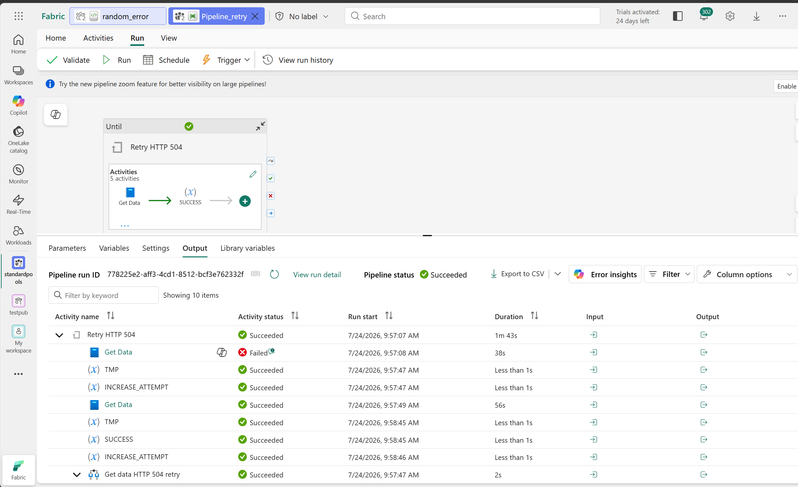

# Fabric Retry Pipeline

A Microsoft Fabric Data Factory pipeline that demonstrates a **granular retry pattern** for a notebook activity, retrying only on specific transient errors (in this example, HTTP `504` responses).



## How it works

The pipeline wraps the notebook call (`Get Data`) inside an `Until` loop and inspects the failure to decide whether to retry:

1. **`Get Data`** – runs the notebook (`random_error.ipynb`).
2. **`SUCCESS`** – on success, reads `activity('Get Data').output.result.exitValue` (the notebook's `mssparkutils.notebook.exit(...)` value) into the `status` variable.
3. **`Get data HTTP 504 retry`** – on failure, checks whether the error message contains `504`:
   - If **yes** → sets `status = RETRY` (loop continues).
   - If **no**  → sets `status = FATAL` (loop exits, no more retries).
4. **`TMP` / `INCREASE_ATTEMPT`** – increments the `attempt` counter after every run.
5. The `Until` expression exits when `status` is `SUCCESS` or `FATAL`, or when `attempt >= maxAttempts` (default `5`).

### Pipeline variables

| Variable      | Type    | Default   | Purpose                                        |
| ------------- | ------- | --------- | ---------------------------------------------- |
| `status`      | String  | `FAILED`  | Loop exit signal (`SUCCESS` / `FATAL` / `RETRY`) |
| `attempt`     | Integer | `0`       | Current retry attempt                          |
| `maxAttempts` | Integer | `5`       | Maximum retries before giving up               |
| `attemptTmp`  | String  | `0`       | Helper for incrementing `attempt`              |

## Alternative: built-in notebook activity retry

You can also use the **standard retry mechanism on the notebook activity itself** by setting `retry` and `retryIntervalInSeconds` in the activity `policy`:

```json
"policy": {
    "timeout": "0.12:00:00",
    "retry": 3,
    "retryIntervalInSeconds": 30
}
```

This is simpler, but retries on **any** failure. The `Until`-loop pattern in this pipeline is **more granular** because it lets you retry only on specific, transient errors (e.g. HTTP `504`) and fail fast on everything else.

## Optional: add a Wait activity between retries

To back off between attempts, add a **Wait** activity inside the `Until` loop (for example after `INCREASE_ATTEMPT`) so the next iteration is delayed:

```json
{
    "name": "Wait before retry",
    "type": "Wait",
    "dependsOn": [
        { "activity": "INCREASE_ATTEMPT", "dependencyConditions": ["Succeeded"] }
    ],
    "typeProperties": {
        "waitTimeInSeconds": 30
    }
}
```

Combine with an expression on `waitTimeInSeconds` (e.g. `@mul(variables('attempt'), 30)`) to implement exponential/linear backoff.

## Files

- [Fabric_pipeline.json](Fabric_pipeline.json) – pipeline definition.
- [random_error.ipynb](random_error.ipynb) – sample notebook that randomly raises an error to exercise the retry logic.
- [Fabric_retry_504.png](Fabric_retry_504.png) – pipeline diagram.
