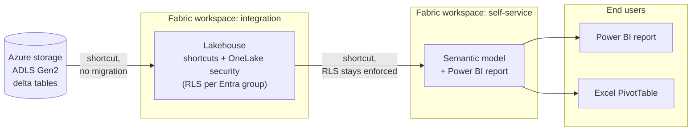
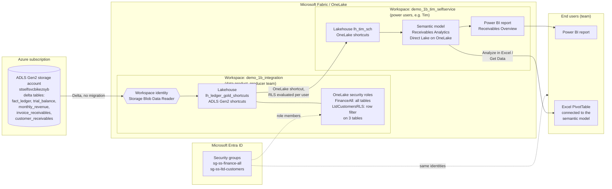

# Self-service BI on Fabric with data kept on Azure storage

Demo: a team that stores its data products as **delta tables on ADLS Gen2** (for example written by Synapse) starts self-service BI in Fabric, **without migrating the data** and **without ACLs on the storage account**.

## Key messages

1. **Data stays on Azure storage.** Delta tables remain in the ADLS Gen2 account. Fabric reads them through OneLake **shortcuts**, so no copy or migration is needed.
2. **No ACLs on the storage account.** Access is governed in Fabric with **OneLake security**: row-level security (RLS) is defined on the tables in the lakehouse and assigned to **Entra security groups**. The storage account only grants one role to the Fabric workspace identity.
3. **Power users work in a separate self-service workspace.** They build the **semantic model** and **Power BI reports** on top of shortcuts to the governed data. RLS keeps applying because OneLake evaluates it with the identity of the reader.
4. **End users analyze the data themselves.** They open the Power BI report, or connect Excel to the semantic model and use a **PivotTable**. Each person only sees the rows their group allows.

## Architecture

### Overview

### Detailed architecture

## Components

| Layer | Item | Purpose |
|---|---|---|
| Storage | `stselfsvcbikezsyb` / `datalake/gold/<table>` | Delta tables stay here. Entra-only access, shared keys disabled. |
| Data product | `demo_1b_integration` > `lh_ledger_gold_shortcuts` | Lakehouse with one ADLS Gen2 shortcut per table. Authenticated with the **workspace identity**. |
| Governance | OneLake security roles on `lh_ledger_gold_shortcuts` | `FinanceAll` reads all tables. `LtdCustomersRLS` reads 3 tables, filtered to the Ltd customers. Members are Entra groups. |
| Self-service | `demo_1b_tim_selfservice` > `lh_tim_sch` | Schema-enabled lakehouse with OneLake shortcuts to the governed tables. |
| Self-service | `Receivables Analytics` | Direct Lake semantic model with relationships and measures (Outstanding, Overdue, Overdue %, ...). |
| Self-service | `Receivables Overview` | Power BI report on the semantic model. |
| Consumption | Excel, Power BI | Excel: Data > Get Data > From Power BI semantic models, then insert a PivotTable. Power BI: open the report. |

## How security works

- **Row-level security** lives on the tables in `lh_ledger_gold_shortcuts` (`SELECT * FROM <table> WHERE customer_id IN (...)`). It is not defined in the semantic model, in Excel or on the storage account.
- **Reader identity flows through.** The Direct Lake model, the SQL analytics endpoint and Spark all read OneLake with the identity of the person querying. The same group membership gives the same rows in every tool.
- **Groups, not people.** Add a user to `sg-ss-ltd-customers` to give Ltd-only access, or to `sg-ss-finance-all` for all tables.

## Required permissions for an end user

| What | Where |
|---|---|
| Member of an OneLake role group | Entra (`sg-ss-ltd-customers` or `sg-ss-finance-all`) |
| Read on the lakehouse | `lh_ledger_gold_shortcuts` (share with the group) |
| Viewer on the self-service workspace, or Read on the report, `lh_tim_sch` and the model | `demo_1b_tim_selfservice` |
| Build on the semantic model (Excel / own reports) | `Receivables Analytics` |

Workspace Admin, Member and Contributor roles **bypass** OneLake security. Only give those roles to power users and the producer team.

## Things to know

- Set both **SQL analytics endpoints** (`lh_ledger_gold_shortcuts` and `lh_tim_sch`) to **User's identity access mode**. The default (delegated identity) does not apply OneLake RLS.
- Spark must read secured tables by table name (`spark.read.table(...)`), not by `abfss://` path. Use a schema-enabled lakehouse (as `lh_tim_sch`) so the OneLake Spark catalog is on.
- OneLake RLS predicates are single-table `SELECT ... WHERE ...` statements. The customer list is static, so a new Ltd customer means updating the role.
- RLS and column-level security for the same user must be in the **same** role.
- In subscriptions with an Azure policy that disables public network access on storage, Fabric shortcuts cannot reach the account unless the account is exempt (here: tag `SecurityControl=Ignore`) or another approved network path is used.

## Demo flow

1. Show the delta tables on the storage account (no changes needed there).
2. Show the lakehouse shortcuts and the OneLake security roles (RLS on the table, groups as members).
3. As Tim (power user): open `demo_1b_tim_selfservice`, show the semantic model and the report.
4. As an end user (for example Karin, member of `sg-ss-ltd-customers`): open the report, then build a PivotTable in Excel on the semantic model. Only the Ltd customers (6 of 30) are visible.
