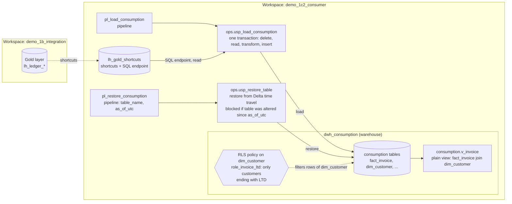
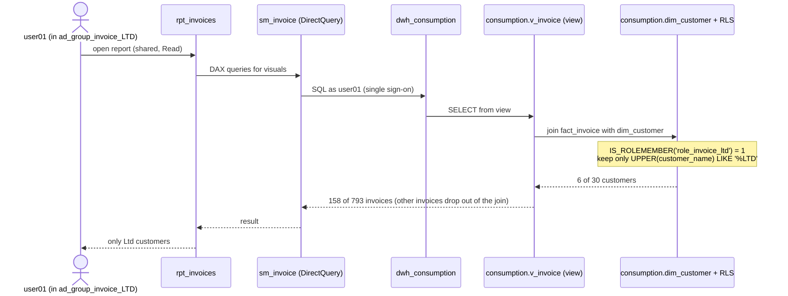

# Modern DWH on Fabric – consumption layer

Transactional full-refresh loading, point-in-time restore, and invoice row-level security
for a Microsoft Fabric consumption warehouse, with pipeline and DirectQuery report deployment.
This sample includes code and generic diagrams only, not source records or exported query results.
Workspace and item names in the diagrams are illustrative.

## Target architecture

| Workspace | Content |
|---|---|
| 1 Ingestion | Mirrored Azure SQL (`sql-ledger-…`) → LH raw; notebook validates → 2nd LH (validated) |
| 2 Integration (`demo_1b_integration`) | Multi-source integration, gold LH; PII (`customer_identity`) stays in a restricted LH |
| 3 Consumption (`demo_1c2_consumer`) | `lh_gold_shortcuts` (shortcuts) → **`dwh_consumption`** (this repo) |

Load pattern in `dwh_consumption` (`ops.usp_load_consumption`, one transaction):
delete production tables → read via the LH SQL endpoint (`lh_gold_shortcuts.dbo.*`) → transform → insert.
Readers use snapshot isolation, so they see either the old or the new data. Any failure rolls back.

Restore (`ops.usp_restore_table`): zero-copy `CLONE … AT <timestamp>` of the Delta version, then
delete + insert in one transaction. Restore point = `ops.load_log.started_utc` of the bad run.

Consumption access (added on top of the base tables): row-level security (RLS) is applied on the **base table that holds the name**,
`consumption.dim_customer`, so members of `ad_group_invoice_LTD` only see customers whose name ends with LTD. The view `consumption.v_invoice`
(invoices + customer attributes) is a plain view that joins `fact_invoice` with `dim_customer`; invoices of customers the caller may not see drop out.
The report `rpt_invoices` uses a DirectQuery semantic model on that view, so the rule applies to report users.
Design choice: no RLS on views (not good practice; a policy on a view also needs `SCHEMABINDING`), the rule lives on the table.
Consequence: creating or changing the policy is an `ALTER` of `dim_customer`, and **restore of that table to a point before the ALTER is blocked** (see [Row-level security](#row-level-security-invoices-for-ad_group_invoice_ltd)).
Details: [Row-level security](#row-level-security-invoices-for-ad_group_invoice_ltd), [Report on the invoice view](#report-on-the-invoice-view),
and the consideration of other semantic model modes in [Semantic model modes](#semantic-model-modes-directquery-import-direct-lake).

## Architecture diagram

From the gold layer in the integration workspace to the consumption tables with row-level security in the consumption workspace,
including the load (pipeline + stored procedure) and the disaster restore (pipeline + stored procedure).
The report and access flow is shown in the sequence diagram below.

PNG downloads: [Architecture](docs/architecture.png) | [Report sequence](docs/report-sequence.png).



What happens when `user01` opens the report (identity flows through, so the filter is applied in the warehouse):



## Deploy / operate

### Prerequisites and configuration

- An existing Fabric workspace, warehouse, and `lh_gold_shortcuts` lakehouse in the same workspace.
- The source tables referenced by `sql\03_usp_load_consumption.sql`: `silver_customer`,
  `customer_identity`, `silver_account`, `silver_fiscal_period`, `silver_invoice`,
  `silver_payment`, `silver_journal_line`, and `silver_journal`. Ingestion, mirroring,
  source data generation, and shortcut provisioning are not included.
- Python, Azure CLI, and Microsoft ODBC Driver 18 for SQL Server.
- Permissions to deploy SQL objects and Fabric items. Use a deployment identity outside `role_invoice_ltd`.

Run from this sample folder. Set your own values in the current PowerShell session;
do not commit tenant details, account addresses, endpoints, credentials, or data exports.
Tokens are obtained at runtime from Azure CLI; no passwords or tokens belong in the sample.
The scripts do not automatically read `.env` files.

```powershell
python -m pip install -r requirements.txt
$env:AZURE_TENANT_ID = "<your-tenant-id>"
$env:FABRIC_WORKSPACE_ID = "<your-consumption-workspace-id>"
$env:FABRIC_WAREHOUSE_ID = "<your-warehouse-item-id>"
$env:FABRIC_SQL_SERVER = "<your-warehouse-sql-endpoint>"
$env:FABRIC_SQL_DB = "dwh_consumption"
az login --tenant $env:AZURE_TENANT_ID
python sql\run_sql.py deploy                       # runs sql\01..05 (sql\demo is not included)
python sql\run_sql.py query "EXEC ops.usp_load_consumption"
python sql\run_sql.py query "EXEC ops.usp_restore_table @table_name='ALL', @as_of_utc='2026-11-17T13:38:55', @dry_run=1"
python sql\run_sql.py query "EXEC ops.usp_restore_table @table_name='ALL', @as_of_utc='2026-11-17T13:38:55'"
```

`AZURE_TENANT_ID` and `FABRIC_SQL_SERVER` are required by all three scripts.
The pipeline and report scripts also require `FABRIC_WORKSPACE_ID`; the pipeline script
additionally requires `FABRIC_WAREHOUSE_ID`. `FABRIC_SQL_DB` defaults to `dwh_consumption`.
Deployment scripts create or update items immediately when run. Restore timestamps shown
here are examples: choose an actual timestamp from your own load log within retention.
Use synthetic data in a disposable demo environment, especially for the corruption demo.

Schedule the load with the Data Pipeline `pl_load_consumption` (Stored procedure activity, parameter `max_drop_pct`,
default 50). Both pipelines are deployed in `demo_1c2_consumer` by `pipeline\deploy_pipeline.py` (`python pipeline\deploy_pipeline.py run pl_load_consumption`
deploys and runs it). In the Fabric UI add a schedule or a trigger on the integration workspace's completion.
The restore is run with the pipeline `pl_restore_consumption` (Stored procedure activity). Run it from the Fabric UI
(*Run* → fill in the parameters) or from the CLI:

| Parameter | Meaning |
|---|---|
| `table_name` | table in schema `consumption` (e.g. `fact_invoice`) or `ALL` (default, consistent restore) |
| `as_of_utc` | UTC timestamp to restore to, e.g. `2026-11-17T13:38:55` (`ops.load_log.started_utc` of the bad run) |

```powershell
python pipeline\deploy_pipeline.py run pl_restore_consumption table_name=ALL as_of_utc=2026-11-17T13:38:55
```

A pipeline does not show query results, so preview with `@dry_run=1` in the warehouse query editor first.

**Restore guard:** `ops.usp_restore_table` refuses (error 50014, pipeline run fails, nothing is changed, logged as FAILED in `ops.load_log`) a restore point
before the last `ALTER` of any table in scope (new column, row-level security policy created/changed/dropped). It compares `@as_of_utc` with `sys.tables.modify_date`.
Choose a later point, or reload from gold with `pl_load_consumption`. Both procedures also refuse to run as a member of `role_invoice_ltd`
(RLS would hide rows from `DELETE`).

PII: only `customer_name` from `customer_identity` is loaded into `consumption.dim_customer`; email and contact name stay out.

## Demo: data corruption and restore

Simulates corrupted data (customer names replaced by gibberish) **only in `dwh_consumption`**; the shared gold lakehouse is not touched.
Scripts are in `sql\demo\` (not part of `run_sql.py deploy`).

1. Run the load (`pl_load_consumption`) so the data is good.
2. Check: `python sql\run_sql.py file sql\demo\02_check_customer_names.sql` → `names_differing_from_gold` = 0.
3. Corrupt: `python sql\run_sql.py file sql\demo\01_corrupt_customer_names.sql` → note the printed `restore_point_utc`.
4. Check again → all names differ from gold.
5. Restore: run `pl_restore_consumption` with `table_name=dim_customer` (or `ALL`) and `as_of_utc=<restore_point_utc>`, in the Fabric UI or:
   `python pipeline\deploy_pipeline.py run pl_restore_consumption table_name=dim_customer as_of_utc=<restore_point_utc>`
6. Check again → 0 differing names.

Talking points:
- The load is a full refresh, so running it after the corruption would simply overwrite the damage. Restore is for damage that has already landed (e.g. bad gold data loaded earlier) while the source is still bad.
- In that case also pause the load schedule until gold is fixed, otherwise the next load re-corrupts the warehouse.
- A restore adds a new Delta version; the corrupted versions stay in the history (30 days).
- A wrong timestamp or table name makes the pipeline fail and changes nothing. The same holds for a restore point before an `ALTER` (e.g. the RLS policy): blocked with an explicit message.

## Row-level security: invoices for `ad_group_invoice_LTD`

`sql\05_security_invoice_ltd.sql` (part of `run_sql.py deploy`; objects are only created when missing, so re-running does not touch the table):

| Object | Purpose |
|---|---|
| `sec.fn_invoice_ltd_filter` + `sec.pol_invoice_ltd` | RLS filter predicate on the **base table `consumption.dim_customer`** (column `customer_name`): members of `role_invoice_ltd` only see customers whose name ends with LTD (case-insensitive, names end in `Ltd`) |
| `consumption.v_invoice` | plain view (no policy): `fact_invoice` joined with `dim_customer`; invoices of customers the caller may not see drop out of the join |
| `role_invoice_ltd` | database role; SELECT granted on the view |

RLS is deliberately **not** on the view (not good practice; it also needs `SCHEMABINDING`). It sits on the table that holds the name.
Non-members (pipeline owner/loader, admins) are not filtered. Currently 6 of 30 customers match (158 of 793 invoices).

**Group membership:** create your own demo Entra group and replace `ad_group_invoice_LTD`
in `sql\role_members_manual.sql` with its display name before running that script.
The numbered deployment does not add group members automatically.

Tested by temporarily adding my own user to the role: as member `dim_customer` returned 6 rows, the view 158 rows / 6 customers (also through the report model with DAX); as non-member 30 and 793.
Load, restore and the corrupt/restore demo (incl. the pipeline) were tested with the policy in place.

Things to know:
- **Changing the policy is an ALTER of `dim_customer`, and restore is then blocked for older restore points.** Time travel cannot go back past an ALTER (engine error 12516; dropping the policy again does not undo it, tested on a scratch table).
  `ops.usp_restore_table` therefore checks `sys.tables.modify_date` first and refuses, with an explicit message and without changing anything, a restore of any table in scope to a point before its last ALTER.
  `@table_name='ALL'` is blocked as a whole when one table is blocked (consistent restore). Alternative after such a change: reload from gold with `pl_load_consumption`.
  Plan RLS changes deliberately and note the time; the same applies to any schema change (new column, ...).
- **`fact_invoice` itself is not filtered.** As a role member with direct table access, `SELECT FROM consumption.fact_invoice` returns all 793 rows (customer ids and amounts, no names). Members must only reach the view: grant the group only the role (SELECT on the view), do not make them workspace Viewer or give them "Read all data using SQL". Consider `DENY SELECT` on the base tables for the role (not tested: could not test as a non-admin user, and ownership chaining through the view is unverified).
- A CLONE inherits the RLS predicate of its source table. `ops.usp_clean_restore_clones` removes the predicate from the temporary `ops.rst_*` clones before they are read and dropped; without it the restore would be filtered and the clone could not be dropped (tested with the policy on `dim_customer`).
- **Never run the load or restore as a member of `role_invoice_ltd`:** `DELETE` would only remove the visible rows. Both procedures refuse to run for members (error 50003 / 50013, tested).
- A CLONE inherits RLS predicates of its source table. `ops.usp_clean_restore_clones` removes predicates from the temporary `ops.rst_*` clones before use and drop; it is a safeguard if a policy is ever placed on a base table.
- Run the load/restore as a user that is **not** in `role_invoice_ltd`.
- Workspace Admin/Member/Contributor typically have elevated permissions that bypass SQL-level RLS (not tested here); test the group with a Viewer-level user.

## Report on the invoice view

`python report\deploy_report.py` deploys (idempotent) in `demo_1c2_consumer`:
- semantic model `sm_invoice`: DirectQuery on `dwh_consumption` → `consumption.v_invoice`, measures *Total Invoiced*, *Open Amount*, *Invoice Count*
- report `rpt_invoices`: 3 cards, bar chart (total per customer) and a table of invoices

DirectQuery passes the viewer's identity to the warehouse, so the RLS on `dim_customer` applies to report users (the view joins to it). Verified through the model
(`executeQueries`) with the policy on `dim_customer`: as non-member 793 invoices / 30 customers, as member of `role_invoice_ltd` 158 invoices / 6 customers (all `Ltd`).

**Give `ad_group_invoice_LTD` access (portal only, there is no REST API for item sharing):**
1. Share the report `rpt_invoices` with the group (Read; no reshare). This also gives access to the semantic model.
2. Share the warehouse `dwh_consumption` with the group with **only Read** (connect), **not** "Read all data using SQL (ReadData)"; the SQL grants on the role then decide what they see.
3. Do **not** add the group as workspace role (Viewer reads all warehouse tables, including `fact_invoice` which is not filtered).
4. Test as a non-admin demo user in your group: open the report and confirm that all visible customer names end in Ltd. Counts depend on your source data.

Validate report sharing and viewer identity propagation in your own tenant; the sample does not grant report or warehouse item access automatically.

## Semantic model modes: DirectQuery, Import, Direct Lake

The report uses **DirectQuery** because the security rule lives in the warehouse (RLS policy on `dim_customer`) and must be evaluated with the viewer's identity.
Other modes are possible, but then the rule has to be defined **in the semantic model** (a DAX role) instead of coming from the warehouse policy.
Considerations only; Import and Direct Lake variants were not built or tested here.

Why the warehouse rule alone does not work with the other modes:
- **Import:** data is copied into the model on refresh with one stored credential (the model owner's). All viewers see the same cached data, so the warehouse rule is never evaluated per user.
- **Direct Lake:** reads tables, not views. Because `dim_customer` now carries a SQL-level security policy, Direct Lake on it would fall back to DirectQuery, so it behaves like the current setup (untested).

| | DirectQuery (current) | Import + model RLS | Direct Lake + model RLS |
|---|---|---|---|
| Where the rule lives | Warehouse table `dim_customer` (RLS policy) | DAX role in the model | DAX role in the model |
| Source | The view `consumption.v_invoice` | View or tables | Tables `fact_invoice` + `dim_customer` (no view) |
| Speed | Every visual queries the warehouse | Fast (cache) | Fast (reads Delta files) |
| Refresh | None | Needed: schedule, or a step after `pl_load_consumption` | No copy to refresh; model reads the latest tables |
| Security | Strongest: viewer identity reaches the warehouse, one rule | Rule duplicated; the refresh identity must **not** be in `role_invoice_ltd` | Rule duplicated; a SQL-level policy on `dim_customer` makes Direct Lake fall back to DirectQuery, so it needs a source without that policy |
| Role members | Group in the warehouse role `role_invoice_ltd` | Group as member of the model role (Security Role Memberships API) | Same as Import |

Notes if you go for Import or Direct Lake:
- Model role filter on `Invoice[customer_name]` (or on `dim_customer` with a relationship to `fact_invoice`): `UPPER([customer_name])` ending in `LTD`, case-insensitive like the warehouse policy.
- Model RLS does not apply to users with write/Build permission on the model (e.g. workspace Admin/Member), and it does not protect direct SQL access; keep the warehouse policy for SQL users.
- Keep the two rules in sync and test both return the same result (158 of 793 invoices, 6 customers today).
- Direct Lake needs no refresh schedule and suits larger data; at this size (793 invoices) DirectQuery is sufficient and has the single, strongest security definition.

## Review of the proposed improvement

**Good**
- Workspace-per-layer gives clear ownership, security and CI/CD boundaries; PII stays outside consumption.
- Shortcuts → no data copy between workspaces; one source of truth.
- Delete + reload in one transaction is simple, idempotent, and also removes rows deleted in the source.
- Readers never see an empty table (snapshot isolation), better than the old backup-table dance: the Delta log *is* the backup.

**Risks / recommendations**
1. **Empty or partial source wipes production.** Mitigated here with two guards (source not empty; table may not shrink > `@max_drop_pct`, default 50 %). Keep them.
2. **SQL analytics endpoint metadata lag.** After the integration job finishes, the LH endpoint can be minutes behind. Trigger a metadata refresh (REST *Refresh SQL endpoint metadata*) before calling the SP, otherwise you load stale data.
3. **Restore point.** Time travel (30 days) is per table commit, so restoring tables to different timestamps gives an inconsistent model. Use `@table_name='ALL'` with a timestamp from `ops.load_log`. Beyond 30 days the history is gone; for longer retention use Delta time travel in the gold LH instead. A restore point before the last ALTER of a table (new column, RLS policy change) is refused by the procedure.
4. **Not a backup against deletion of the warehouse/workspace** (time travel dies with it); use warehouse restore points / DR if needed.
5. **Delete + insert write amplification.** Fine for small data (this demo: <5k rows). Beyond ~10s of millions rows or frequent runs, switch to `MERGE`/incremental by key or by partition (load window) – you lose automatic handling of source deletes unless you add a tombstone/soft-delete flag.
6. **Mirroring prerequisites.** If the source SQL has public access disabled or Entra-only authentication, verify supported authentication and network connectivity before building WS1. A mirrored database is a separate item; expose it to the lakehouse via shortcuts.
7. **Naming.** The consumer LH shortcuts point at `lh_ledger_shortcuts` (silver_* tables) in integration; `lh_ledger_gold` there is still empty. Re-point the shortcuts to real gold tables once `nb_ledger_gold` populates them.
8. **PII.** Only `customer_name` from `customer_identity` is loaded into the DWH (email/contact name are not). Review shortcut security mode (user vs delegated identity) on the consumer LH and consider dynamic data masking on `customer_name`.
9. **Operations.** Alert on `ops.load_log.status='FAILED'`; DDL changes are not transactional, so schema changes are deployed separately (item `01`), and a restore after schema drift or an RLS change is refused (nothing changed).

## Fabric warehouse specifics found while building
- `SET XACT_ABORT` is not supported (TRY/CATCH + `ROLLBACK` used instead).
- Temp tables cannot be combined with user tables in one query → logging uses permanent `ops.*` tables.
- `FOR TIMESTAMP AS OF` inside a transaction after a DELETE did not return the historical rows; hence the clone-then-swap restore.
- Time travel cannot go back past an `ALTER` of a table (error 12516); `sys.tables.modify_date` shows the last ALTER (DML does not change it). Creating/dropping a row-level security policy on a table counts as an ALTER of that table.
- A security policy on a view is possible but needs `WITH SCHEMABINDING` on the view; not used here (RLS sits on the base table).
- A CLONE inherits the RLS predicate of its source; remove it from the clone before dropping it (`ops.usp_clean_restore_clones`).
- Not supported in Fabric warehouse T-SQL: `COL_LENGTH`, `DATABASE_PRINCIPAL_ID`, `SET XACT_ABORT` (use `sys.columns` / `sys.database_principals`). `IS_ROLEMEMBER` works.
